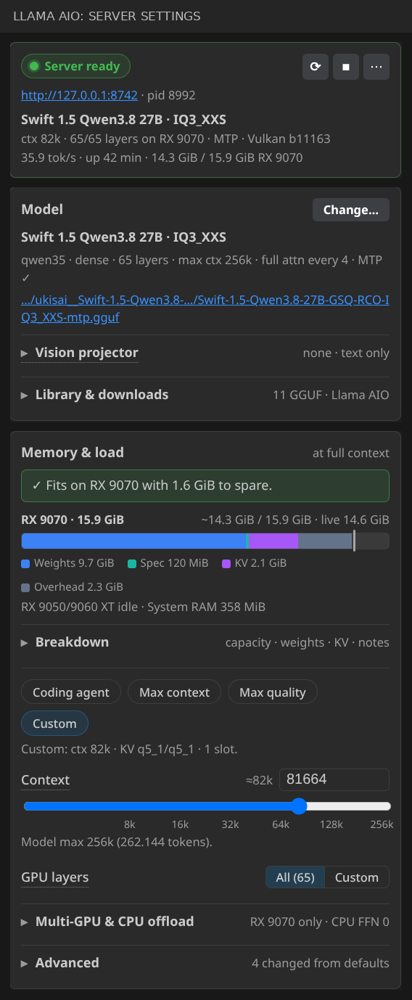
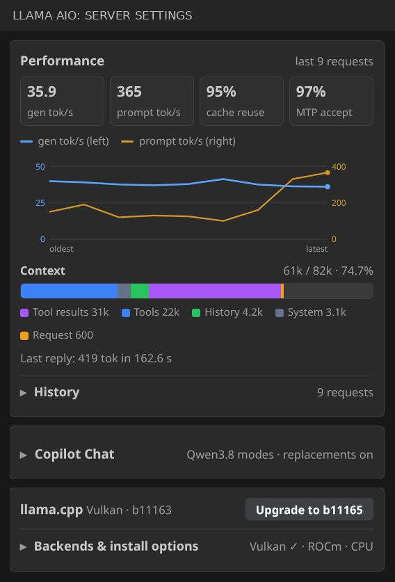
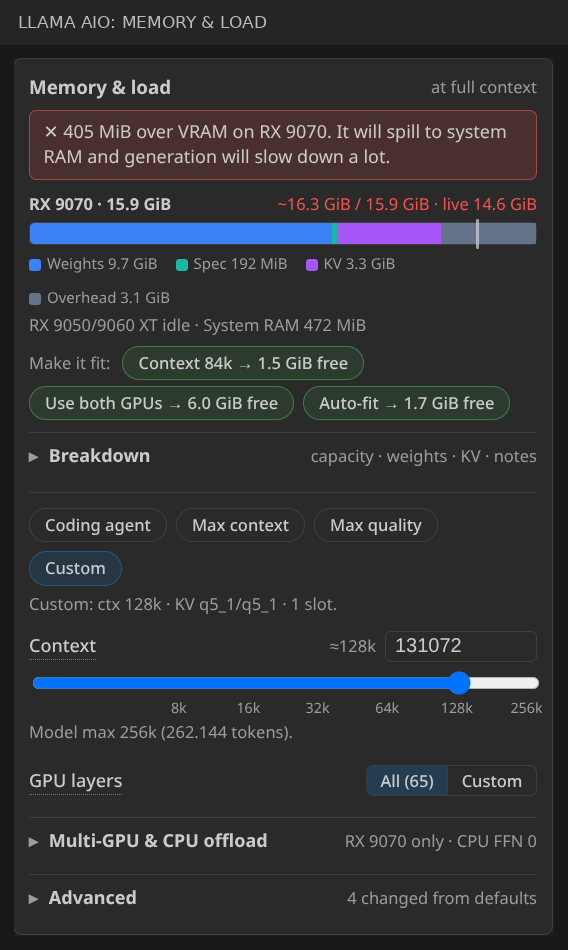
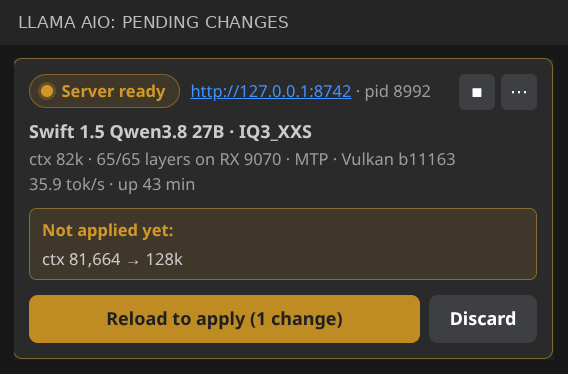

# Llama AIO for VS Code

Run local LLMs with **llama.cpp** and use them in **GitHub Copilot Chat** — without leaving VS Code.

Llama AIO installs llama.cpp for you, finds or downloads GGUF models, tells you whether a model fits on your GPU before you load it, and runs one `llama-server` that all your VS Code windows share.

  
  

## Get started

1. Open the **Llama AIO** view in the activity bar.
2. Install llama.cpp (Vulkan, CUDA or CPU — picked for your hardware).
3. Choose a model: **Change…** lists GGUF files already on disk (Llama AIO, LM Studio, Unsloth, Hugging Face cache) or searches Hugging Face. First time? Use the one-click starter model.
4. Press **Start**, then pick **Llama AIO: …** in the Copilot Chat model picker.

## Know if it fits — before you load it

The **Memory & load** card estimates VRAM and RAM at full context and gives one clear answer: fits, tight, or will spill to system RAM. When it doesn't fit, it offers one-click fixes such as a shorter context, using an idle second GPU, or a smaller KV cache — each checked against the estimate before it's shown.

  

- **Presets:** Coding agent, Max context (largest context that fits), Max quality.
- **Main controls:** context length, GPU layers, multi-GPU split, CPU offload for MoE/FFN layers.
- **Advanced:** threads, batch sizes, KV cache types, flash attention, reasoning, RoPE and speculative decoding (MTP, DFlash, n-gram). Filter by name or flag, or show only what you changed.

Newer llama.cpp builds also support a **GPU expert cache**, **draft sampling**, and a separate **draft batch size**. Llama AIO checks the active binary before using these flags. Expert caching defaults to off because it needs extra VRAM; draft batch size defaults to inheriting the main batch. Draft sampling defaults to Auto, which enables probabilistic MTP when supported and keeps DFlash's existing behavior. See [performance settings](docs/performance-settings.md) for compatibility and tuning details.

## See what's running

The header always shows the loaded model, context, GPU layers, speed and memory. Change a setting while the server runs and it lists exactly what will change — apply with **Reload**, or **Discard** to go back.

  

The **Performance** card shows generation and prompt speed, cache reuse, speculative acceptance, and what fills your context (tools, tool results, history…).

## Copilot Chat

The running model appears in Copilot Chat as **Llama AIO: …**, including Agent mode with streamed replies and tool calls. Curated sampling modes are applied automatically for well-known model families; otherwise set temperature, top-p/k and max tokens under **Chat Requests → Sampling**.

Thinking modes also work in Copilot CLI sessions. That picker uses standard effort names: for Qwen3.8 / Flash-Next, **XHigh**, **Medium**, **Low**, and **None** select the corresponding thinking presets and No Think. Existing chats with the older preset names remain supported.

Profiles also cover Spark X2.5/X2.6, GPT-OSS, GLM-5.3/Flash, DeepSeek V4.1 Flash, Tiel-Coder, MiniCPM5, FrogNano 4B 2609, Nanbeige4.3 33B, Mellum2.1, MiMo Distill, Saluki, Flint, Sage, selected Ornith and Nemotron checkpoints, LFM2.5, Bonsai 2, and Qwen Coder/Instruct variants. See the [profile catalog](docs/model-profiles.md) for exact versions, defaults, sources, and runtime requirements.

The llama icon is supplied for both the provider and its models. VS Code 1.142 ignores the provider icon, and its Copilot CLI bridge does not carry custom model icons into CLI sessions, so those surfaces show VS Code's generic icon. The extension cannot override those host controls.

## Good to know

- **Strata:** the sidebar detects Desktop's public API on `47831`, the standalone server on `8095`, the launcher on `8080`, and the source-run host on `8791`, then offers **Connect**. Other ports are discovered when process information is available. Served model names, canonical aliases, and Desktop model labels select the matching chat profile, including Swift 1.5 and short IDs such as `q2_0` for Qwen3.8 Flash-Next. Desktop chooses a different free port if `47831` is occupied.
- **Remote context:** temporary outages and Strata reloads keep the last known model, profile, and context visible for the current connection. Chat waits for a loaded model, and a newly reported context replaces the remembered value, including when it is smaller.
- **Large prompts:** compatible llama.cpp servers count the rendered text prompt before inference and reserve the remaining space for the reply. Other servers retain estimates and decide whether the request fits. The sidebar shows “Waiting for first token…” during prefill.
- **Library refresh:** use the refresh button beside the library filter after copying models into a watched folder. Filters also match GGUF filenames when metadata supplies a different display name.
- **One shared server** at `http://127.0.0.1:8742` for all VS Code windows. It starts in an external terminal (logs visible) or in the background, and always requires a per-user API key (`~/.llama-aio-vs/runtime/local-api.key`, created on first launch) so loopback stays a transport detail, not an authentication boundary. The extension and TUI send the key automatically.
- **Backends:** Vulkan (default, good for AMD), CUDA (NVIDIA), CPU, or a `llama-server` already on your `PATH`. Upgrades are swapped in only after a successful download; pin a release tag or install from an archive if you need to.
- **Licences:** the Hugging Face picker shows each model's licence and warns before downloading anything that isn't clearly permissive.
- **Vision:** attach an `mmproj` projector to send images (added automatically when one sits next to the model).
- **Files:** everything lives under `~/.llama-aio-vs/` — binaries, models, `config.json`, and the server log.

## Settings

Run **Llama AIO: Open Configuration File** to edit `~/.llama-aio-vs/config.json`. Useful keys in the `app` section:

| Key | What it does |
| --- | --- |
| `port` / `host` | Server address (default `8742` / `127.0.0.1`) |
| `modelsDir` / `extraModelDirs` | Where models are downloaded / extra folders to scan |
| `hfToken` | Token for gated or private Hugging Face models. VS Code stores the token in Secret Storage (sidebar → Hugging Face token) and migrates an existing value out of `config.json`; the TUI reads `HF_TOKEN` / `HUGGING_FACE_HUB_TOKEN` or this key. |
| `backend` | `auto`, `vulkan`, `cuda`, `cpu`, `rocm`, … |
| `launchMode` | `externalTerminal` (default) or `background` |
| `autoStart` | Start the server when VS Code opens |

All commands are in the Command Palette under **Llama AIO:** — start/stop/reload, open log, copy the server command line, install llama.cpp, download models, and view the last Copilot request or response.

## Requirements

- VS Code 1.109 or newer
- GitHub Copilot Chat for the chat integration
- code-server, VSCodium and other editors that install from Open VSX can run the server, model library and downloads, but Copilot Chat isn't available there. The models can still be used by other extensions that support the VS Code Language Model API.
- Linux, Windows or macOS; a GPU is optional

## Building and releasing

Run `npm ci`, `npm run compile`, and `npm run package:vsix` to build the extension into `dist/`.

The **Build VSIX** GitHub Actions workflow checks, tests, and packages every pull request and push to `main`. Publishing a GitHub release with a tag matching the package version (for example, `v0.3.3`) also attaches the VSIX to that release. Update all workspace package versions and the lockfile together before releasing. To retry an existing release, run the workflow manually with its tag.

## License

[MIT](LICENSE) © 2026 Timo Leser
