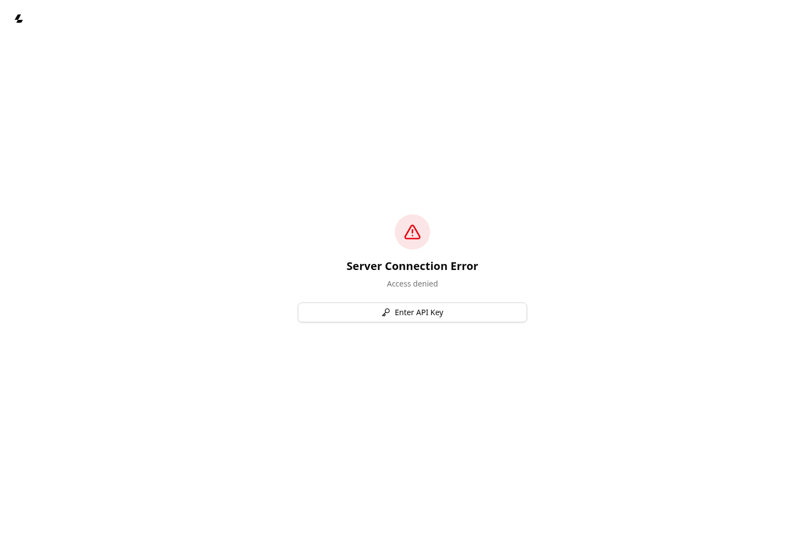
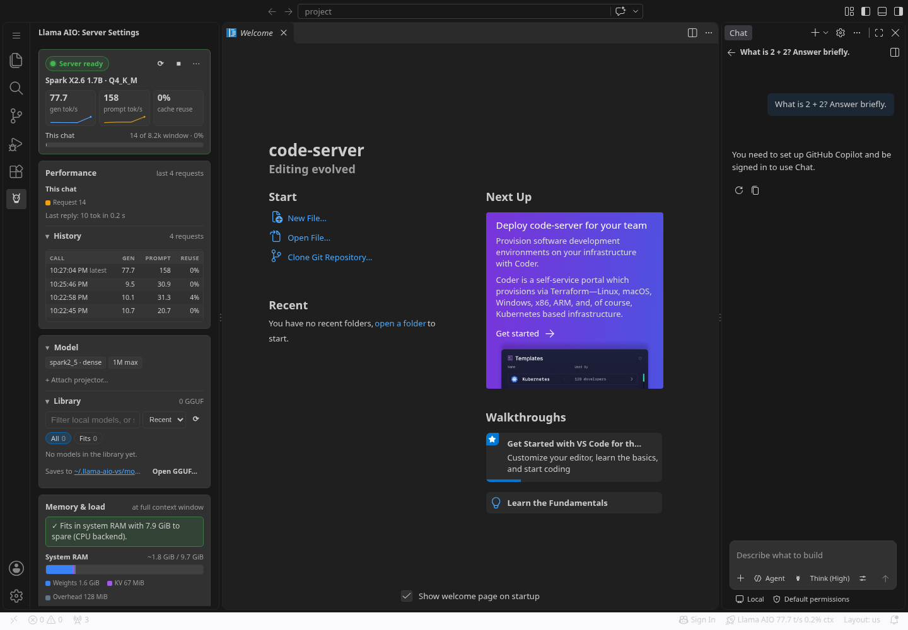
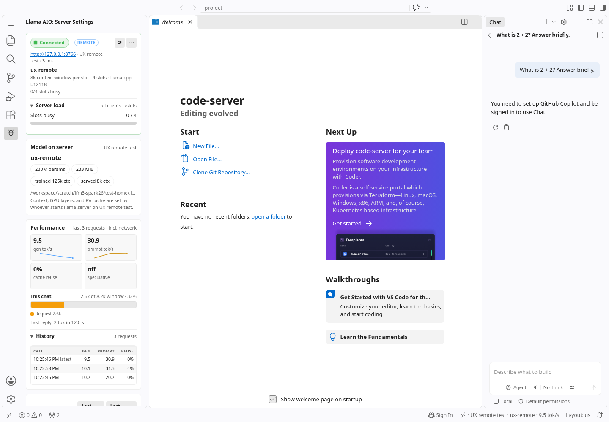
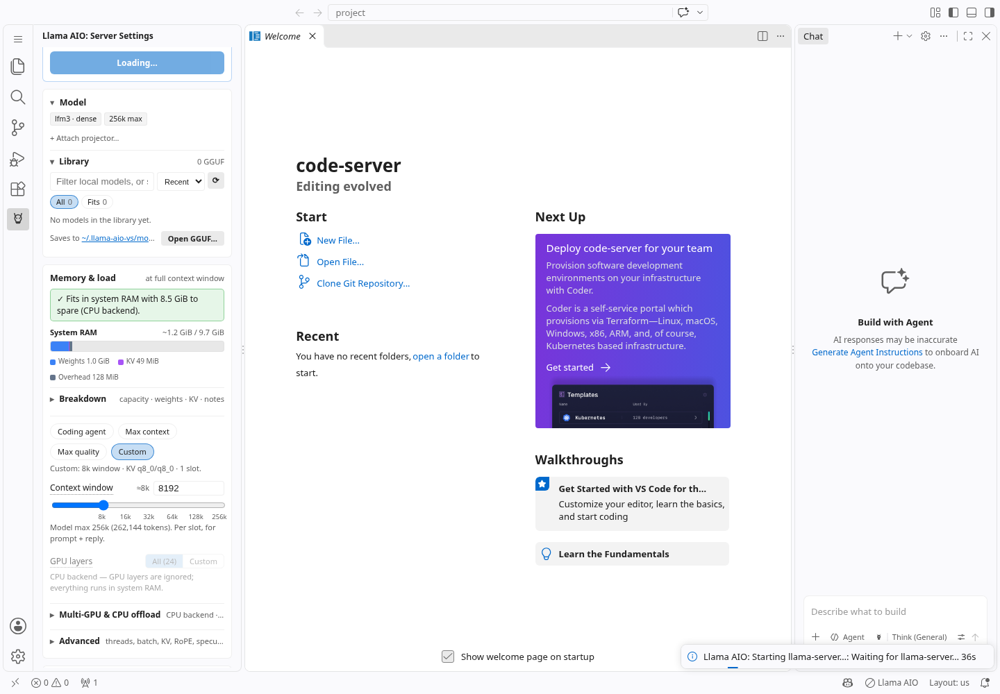
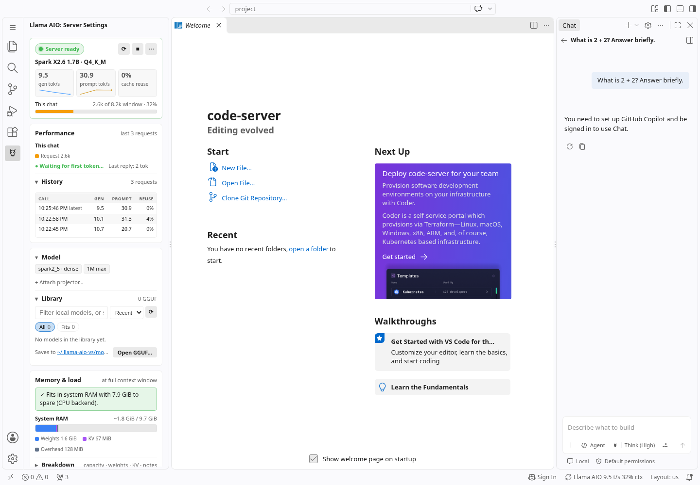
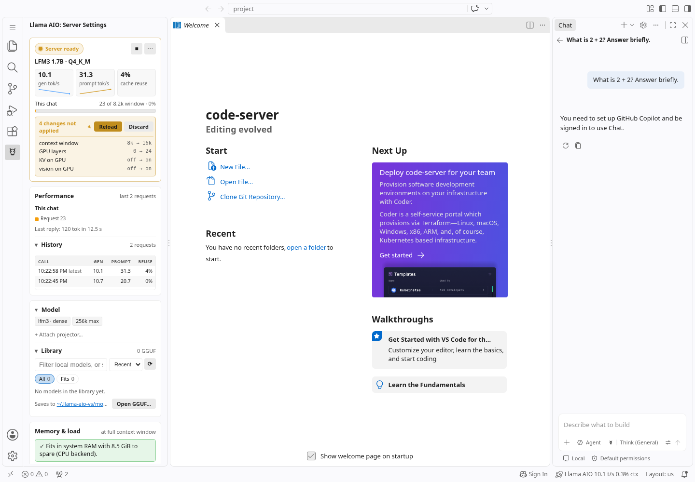

## Summary

Hands-on review of the **real packaged VS Code extension**, with real CPU inference, found six actionable UX/behavior problems. Overall UX rating: **7/10**. Prioritize authentication access and trustworthy request statistics before visual polish.

This issue is a self-contained implementation handoff. Screenshots are from the real editor, not the standalone sidebar harness. Code links are pinned to the exact tested commit; implementation suggestions below are starting points, not claims that a fix has already been validated.

## Tested environment and scope

- Repository revision: [`5f160c527dda04b21b308036dba66dfa90efc3da`](https://github.com/erpel-dev/llama-aio-vs/commit/5f160c527dda04b21b308036dba66dfa90efc3da), `features/runtime-controls`, including #32. Packaged VSIX version **0.3.9**; identify by commit rather than version alone.
- 2026-11-04, approximately 22:17–22:29 UTC. Fresh editor profile and trusted test workspace.
- Linux x64, headless Chromium, **code-server 4.141.0 / VS Code 1.141.0**, approximately 297px sidebar. CPU-only container, 2 CPU quota / 8 GiB cgroup limit; the OS reports more host resources. Do not treat memory-fit estimates in these screenshots as GPU validation.
- **llama.cpp CPU b12118 (`9e2a04a43`)**, installed through the extension UI.
- Local models: `LFM3-1.7B-Q4_K_M.gguf`, `Spark-X2.6-1.7B-Q4_K_M.gguf`, both opened from a directory outside the real user's default library. Local serving context: **8192**.
- Remote test: a separate real `LFM2.5-230M-Q8_0.gguf` server on loopback, connected through the extension's remote mode. No Strata process was used.
- Real calls used the extension's **VS Code Language Model API provider**. Copilot's actual model-mode controls were inspected, but signed-in Copilot Chat/SDK was unavailable. The sign-in notice in some screenshots belongs to the editor, not to a failure of these provider calls.
- No GPU test, 50K-token request, or long-duration soak test was performed in this review. The longer prompt below was approximately **2.6K tokens**, cancelled during prefill.

## 1. High: managed local web UI opens into an API-key dead end

**Reproduce**

1. Start a model using the extension's managed local server; Background mode works in this environment.
2. Choose server **⋯ → Open llama.cpp web UI**.
3. The browser opens the UI; in code-server it was forwarded through `/proxy/8742/`.

**Actual:** “Server Connection Error → Access denied → Enter API Key”. The extension generated the local key, but the sidebar has no nearby action to retrieve/copy it. Remote key management does not solve this local-server workflow.

**Expected / acceptance criteria**

- [ ] A user can open and use the managed server's web UI, or retrieve its key through a clearly labeled **Copy local API key** action and paste it into the web UI.
- [ ] Explain that this is the locally generated llama.cpp server key. Preserve authentication; do not solve the UX problem by disabling it.
- [ ] Keep credentials out of logs, diagnostics, command previews, and URL query strings. Test desktop external browser and code-server forwarding.

**Code starting points:** [web UI button handler](https://github.com/erpel-dev/llama-aio-vs/blob/5f160c527dda04b21b308036dba66dfa90efc3da/packages/vscode/src/webview/sidebar.ts#L3239) currently opens only `lastEndpoint`; [openExternal message](https://github.com/erpel-dev/llama-aio-vs/blob/5f160c527dda04b21b308036dba66dfa90efc3da/packages/vscode/src/settingsView.ts#L560); [local API key helpers](https://github.com/erpel-dev/llama-aio-vs/blob/5f160c527dda04b21b308036dba66dfa90efc3da/packages/core/src/localApiKey.ts#L33); [key passed to managed server via environment](https://github.com/erpel-dev/llama-aio-vs/blob/5f160c527dda04b21b308036dba66dfa90efc3da/packages/core/src/processManager.ts#L817).



## 2. High: statistics are attributed to the wrong model/request after switching or cancelling

**Reproduce A — model/server change**

1. Generate a response with local LFM3; this session measured **10.1 gen tok/s**.
2. Select Spark, reload successfully, and inspect the header before its first request. It retains LFM3's speed/context occupancy.
3. Generate on remote LFM2.5; this session measured **77.7 gen tok/s**.
4. Switch back to the local Spark server and start it. The header says **Spark X2.6 1.7B** but displays **77.7 tok/s** from the remote 230M model.

**Reproduce B — cancelled prefill**

1. On Spark, ask `What is the capital of France? Answer with only the city name.` using No Think. The answer was `Paris`, 2 server completion tokens.
2. Send a roughly 2.6K-token prompt and cancel after 12 seconds before any output.
3. The provider returned empty text/thinking, but the sidebar displayed **“Last reply: 2 tok in 12.0 s”**: the previous answer's token count paired with the cancelled request's duration.

**Expected / acceptance criteria**

- [ ] Current/live metrics and context occupancy belong to the active server/model and request; show an unmeasured state after a target/model change.
- [ ] If retaining history across targets, include model/server identity or filter it appropriately. Current history rows have timestamps only.
- [ ] Distinguish completed, cancelled, and failed requests. A request cancelled during prefill must not borrow the previous answer's token count.
- [ ] Token count, duration, rate, and context come from the same request. Clear error/cancellation state when the next call begins.
- [ ] Preserve intentional last-call statistics during a new request on the **same** target if clearly labeled; do not indiscriminately remove that useful feature.

**Code starting points:** [PerfStats state and history](https://github.com/erpel-dev/llama-aio-vs/blob/5f160c527dda04b21b308036dba66dfa90efc3da/packages/core/src/perfStats.ts#L169), especially `begin`, `abort`, `PerfCallSummary`; [renderPerfStats](https://github.com/erpel-dev/llama-aio-vs/blob/5f160c527dda04b21b308036dba66dfa90efc3da/packages/vscode/src/webview/sidebar.ts#L1282) takes `completionTokens` from history when missing but duration from the current aborted request; [provider cancellation](https://github.com/erpel-dev/llama-aio-vs/blob/5f160c527dda04b21b308036dba66dfa90efc3da/packages/vscode/src/chatProvider.ts#L1074); [connectRemote/switchToLocal](https://github.com/erpel-dev/llama-aio-vs/blob/5f160c527dda04b21b308036dba66dfa90efc3da/packages/vscode/src/settingsView.ts#L894). Look for a target/request identity boundary rather than just hiding the symptom in one tile.

**Suggested regressions:** complete A → activate B → no B request; local → remote → local; complete 2-token request → begin → abort without output; cancellation after partial output; late events from an old request after switching targets. Extend `packages/core/test/perfStats.test.ts`, provider/settings tests, and real-webview coverage as appropriate.



The following screenshot, immediately after connecting remotely and before generating there, also shows the cancelled local request's misleading **2 tok in 12.0 s** summary:



## 3. Medium: first-run setup exposes too many competing actions

**Reproduce:** use a fresh configuration/editor profile with no model/runtime and open Llama AIO settings. Avoid modifying an existing user's configuration when reproducing.

**Actual:** starter-model download is offered in the onboarding block and again in the Model block. Start, context presets, and GPU/load controls appear before prerequisites are ready; runtime installation is farther down the sidebar. This is a usability finding, not a claim that installation failed: CPU installation succeeded.

**Expected / acceptance criteria**

- [ ] One prominent next action guides the user through **runtime → choose/download model → start → test response** (or offers remote connect).
- [ ] Avoid duplicate starter calls to action and clarify unmet prerequisites before Start.
- [ ] Keep expert controls available, but progressively reveal or collapse irrelevant details during onboarding.
- [ ] Verify fresh setup, runtime-only installed, model-only selected, and fully ready states at a narrow sidebar width.

**Code starting points:** [`setupStarterBtn` and `starterModelBtn`](https://github.com/erpel-dev/llama-aio-vs/blob/5f160c527dda04b21b308036dba66dfa90efc3da/packages/vscode/src/webview/sidebar.html#L116); [sidebar state rendering](https://github.com/erpel-dev/llama-aio-vs/blob/5f160c527dda04b21b308036dba66dfa90efc3da/packages/vscode/src/webview/sidebar.ts#L2696). No unobstructed first-run screenshot was retained; this observation came from the live UI and should be rechecked during implementation.

## 4. Medium: external-terminal default stalls without actionable recovery in a headless editor

**Reproduce:** in Linux browser/headless code-server with no usable graphical terminal, install the CPU runtime, select LFM3 at 8192 context, leave the default External terminal launch mode, then Start.

**Actual:** approximately 45 seconds of “Waiting for llama-server” with no actual server process and connection refused on the local health endpoint. Stop worked. **⋯ → Launch mode → Background**, then Start, loaded the same model successfully. The screenshot catches the wait at 36 seconds.

This is **environment-specific**. It does not establish that normal desktop VS Code terminal launching fails. Do not impose a short model-loading timeout that breaks genuinely slow large-model starts.

**Expected / acceptance criteria**

- [ ] Browser/headless environments use a suitable default or receive an early, explicit **Try Background mode** recovery action when terminal launching fails.
- [ ] Preserve an explicitly chosen desktop launch mode.
- [ ] Distinguish terminal-launch failure from a live server still loading a large model. Stop cancels startup cleanly.

**Code starting points:** [`resolveLaunchMode`](https://github.com/erpel-dev/llama-aio-vs/blob/5f160c527dda04b21b308036dba66dfa90efc3da/packages/core/src/externalTerminal.ts#L407), [`spawnInExternalTerminal`](https://github.com/erpel-dev/llama-aio-vs/blob/5f160c527dda04b21b308036dba66dfa90efc3da/packages/core/src/externalTerminal.ts#L267), [process launch and readiness loop](https://github.com/erpel-dev/llama-aio-vs/blob/5f160c527dda04b21b308036dba66dfa90efc3da/packages/core/src/processManager.ts#L832). Keep editor-specific environment detection in the adapter where possible.



## 5. Medium: Open GGUF models remain absent from the Library

**Reproduce:** place a GGUF outside the configured/common scanned library directories, choose **Library → Open GGUF**, select it, and run it. Repeat with another external model.

**Actual:** LFM3/Spark metadata and profiles are recognized and inference works, while Library says **“0 GGUF” / “No models in the library yet.”** Returning to the previously opened model requires browsing again.

**Expected / acceptance criteria**

- [ ] Include recently opened external models, or offer an obvious **Add containing folder** action; make scan scope clear if the Library count intentionally excludes them.
- [ ] Avoid duplicate entries for symlinks/scanned files and handle moved/deleted recent files gracefully.
- [ ] Adding an external model must not make it extension-owned or enable deletion of arbitrary external files. Preserve existing ownership checks.

**Code starting points:** [selection callback](https://github.com/erpel-dev/llama-aio-vs/blob/5f160c527dda04b21b308036dba66dfa90efc3da/packages/vscode/src/extension.ts#L772); [library payload construction](https://github.com/erpel-dev/llama-aio-vs/blob/5f160c527dda04b21b308036dba66dfa90efc3da/packages/vscode/src/settingsView.ts#L1408); [`listLocalModelEntries`/scan cache](https://github.com/erpel-dev/llama-aio-vs/blob/5f160c527dda04b21b308036dba66dfa90efc3da/packages/core/src/modelLibrary.ts#L985); [empty-library rendering](https://github.com/erpel-dev/llama-aio-vs/blob/5f160c527dda04b21b308036dba66dfa90efc3da/packages/vscode/src/webview/library.ts#L328). Existing library/removal tests cover important ownership behavior.



## 6. Medium: CPU context edit reports three irrelevant GPU changes

**Reproduce**

1. Use CPU backend, with saved GPU preferences left at their defaults, and launch LFM3 at context 8192.
2. Change only Context window to 16384; expand the pending-change list.

**Actual:** **4 changes not applied**: context `8k → 16k`, GPU layers `0 → 24`, KV on GPU `off → on`, vision on GPU `off → on`. CPU mode ignores those GPU fields. Discard restored 8192 successfully.

**Expected / acceptance criteria**

- [ ] A CPU-only context edit reports only effective changes, consistent with server dirty/fingerprint logic.
- [ ] Compare launched and pending settings with the same CPU normalization.
- [ ] Preserve saved GPU preferences for a future backend switch; do not silently overwrite them merely to hide false differences.
- [ ] Verify real changes remain visible on GPU backends, and Discard/Reload still work.

**Code starting points:** [`pendingChanges`](https://github.com/erpel-dev/llama-aio-vs/blob/5f160c527dda04b21b308036dba66dfa90efc3da/packages/vscode/src/settingsView.ts#L730) currently compares raw pending state to normalized launched settings; compare [CPU-normalized config fingerprint](https://github.com/erpel-dev/llama-aio-vs/blob/5f160c527dda04b21b308036dba66dfa90efc3da/packages/core/src/processManager.ts#L487) and [`normalizeLoadSettingsForCpuBackend`](https://github.com/erpel-dev/llama-aio-vs/blob/5f160c527dda04b21b308036dba66dfa90efc3da/packages/core/src/serverArgs.ts#L83). Extend `packages/vscode/test/settingsView.test.cjs` beyond its existing pending-change/discard test.



## Reproduction helper for the provider/cancellation case

Run this **inside a small test extension's extension host**, with the real packaged Llama AIO extension enabled and a model already running. It exercises the actual provider without requiring a signed-in Copilot UI. Replace the effort only if the tested model exposes a different profile schema.

```js
const vscode = require('vscode');
async function run(prompt, cancelAfterMs = 60000) {
  const [model] = await vscode.lm.selectChatModels({ vendor: 'llama-aio' });
  if (!model) throw new Error('No Llama AIO model exposed');
  const cancel = new vscode.CancellationTokenSource();
  const timer = setTimeout(() => cancel.cancel(), cancelAfterMs);
  try {
    const response = await model.sendRequest(
      [vscode.LanguageModelChatMessage.User(prompt)],
      { modelOptions: { reasoningEffort: 'none' } }, cancel.token);
    let text = '';
    for await (const part of response.stream) {
      if (part instanceof vscode.LanguageModelTextPart) text += part.value;
    }
    return text;
  } finally { clearTimeout(timer); cancel.dispose(); }
}
await run('What is the capital of France? Answer with only the city name.');
await run('Read these numbered items, then answer only DONE.\n' +
  Array.from({length: 140}, (_, i) =>
    `${i}: The project contains a parser, a loader, and a user interface.`)
    .join('\n') + '\nAnswer DONE.', 12000);
```

The second call may complete on faster hardware. To reproduce cancellation before output, increase the prompt within the configured context or shorten cancellation while ensuring the request has actually started; do not assume a fixed CPU timing everywhere.

The remote test used a **second real server**, independently started on loopback:

```sh
llama-server -m /path/to/LFM2.5-230M-Q8_0.gguf \
  --host 127.0.0.1 --port 8766 -c 8192 -t 2 -ngl 0 \
  --alias ux-remote --cache-ram 0
```

This temporary loopback test server had no API key and is not a proposed change to managed-server authentication. Connect to `http://127.0.0.1:8766`, generate, then switch back to the local model for the statistics case. Gracefully stop/restart only this test server for outage recovery checks.

## Preserve working behavior / validation

- LFM3 direct answer and reasoning output worked; Spark No Think returned `Paris`; remote LFM2.5 returned a greeting. Spark's actual editor picker showed **Think (High), Think (Low), No Think**.
- Pending model selection correctly identifies the old running model and the new **not loaded** selection. Preserve that separation and profile choice until reload.
- Remote `/props` distinguished trained context from served **8K per slot**. During an outage, the UI retained the last-known model/context and reconnected after restart. Do not regress this while clearing performance state: context discovery/cache and per-request statistics are separate concerns.
- Context Discard and prompt-cache RAM persistence worked. Both themes fit the tested 297px sidebar without horizontal overflow.
- No sustained freeze was observed. Across 112 five-second samples the shared extension host had median CPU ~1.46%, peak RSS ~239 MiB, max sampled event-loop delay ~203 ms. These measurements include other editor extensions/test instrumentation; they do not establish isolated extension costs, a performance bottleneck, or long-term stability.
- Suggested checks after fixes: `npm test`, `npm run lint`, `npm run compile`, `npm run package:vsix`, plus repeat the real-editor reproductions above. Tests passing alone do not validate web UI authentication or terminal recovery.

No application source was changed during the review; the original shared configuration was restored and test processes were stopped. Screenshot filenames preserve capture order. Some screenshots show the unrelated editor sign-in gate; real inference evidence came from the provider calls described above.
